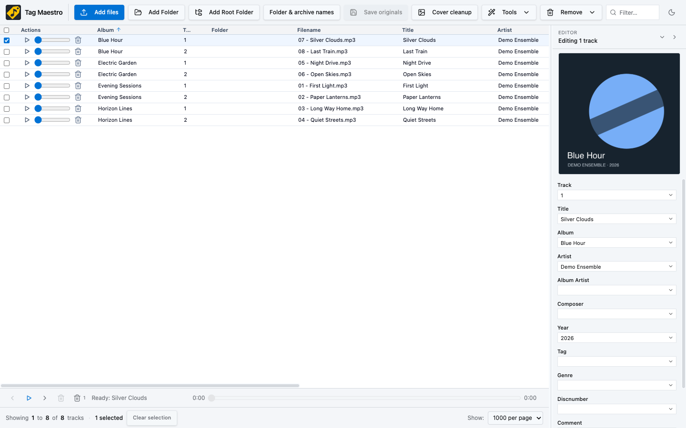
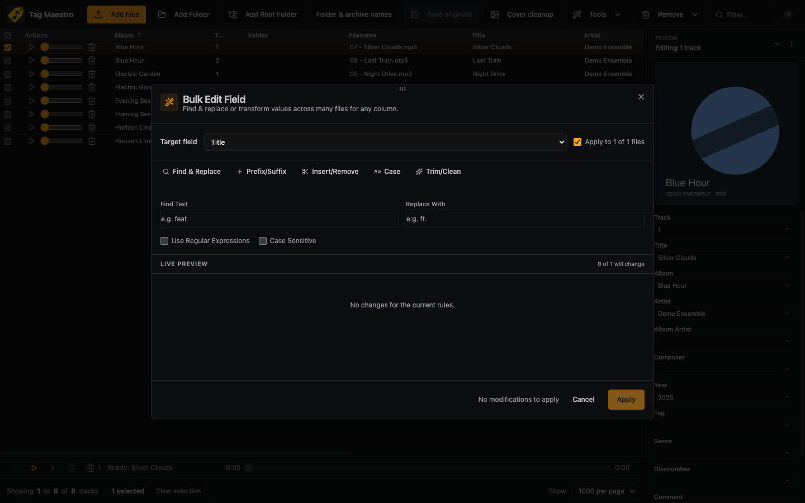

# Tag Maestro

Organize your music library: edit tags and embedded artwork, preview songs, and rename original album folders and archives without making duplicate copies.

[Download Mac & Windows apps](https://github.com/BASF2HD/tag-maestro/releases/latest) · [Download website](https://basf2hd.github.io/tag-maestro/) · [Release notes](RELEASE-NOTES.md)

## Screenshots

These are actual app screens with synthetic demo songs and artwork. No personal library data is included.





## Install the standalone app

| Computer | Download | How to run |
| --- | --- | --- |
| Apple Silicon Mac | `.dmg` or Mac `.zip` | Open the DMG and copy the app to Applications, or unzip and open the `.app` to try it first. |
| Windows x64 | `Setup.exe` | Run the installer; choose its destination. |
| Windows x64, no installation | `Portable.exe` | Run the portable executable. |

No Node.js, development tools or separate browser are needed for these packages. Current Mac downloads are arm64, not Intel Mac builds. Downloads are unsigned and not Apple-notarized; an operating-system warning is expected. Verify the version, source and `SHA256SUMS` from the same release. Do not disable system security globally to run an unfamiliar download.

The GitHub Pages site is a download/information page. It is not the desktop app.

## Start with a small test folder

1. Back up your originals. Choose **Add Folder** or **Add Root Folder** to load an album or library. This is the preferred route for saving changes directly to originals.
2. Single-click a row to select it. Double-click a cell to edit it, or use the editor on the right. Select multiple rows for shared edits.
3. Use **Tools → Bulk edit** for find/replace and other transformations. Inspect the live preview before applying.
4. Click **Save originals**. Writes are checked by reading the files back. Staged edits are not saved merely by changing a field.
5. For listening checks, use each row's play/seek controls or the bottom playback bar.

**Deletion is immediate and permanent**, including **Delete selected**. It deletes song files, not just rows. Back up before pruning a library. The separate **Remove** menu unloads entries from the app without deleting music.

## Tags, tables and playback

- Edit title, artist, album, album artist, composer, genre, year, track, disc number, tag, comment and BPM. Multi-selection supports keeping existing values, setting a shared value or clearing a field, including comments.
- Bulk editing has a **Target field** selector for tags, filename and folder name. Operations include literal/regular-expression find/replace, case-sensitive matching, prefix/suffix, insert/remove, case conversion and whitespace cleanup.
- Additional tools convert tags, extract text into tags, split text across tags and reload tags from files.
- Drag columns to reorder them; column widths, visibility, sorting and page-size preferences persist across reloads. Album is the default sort column.
- Row actions offer play/pause, quick seek and deletion. The bottom bar adds previous/next, seek and selected-song deletion. The playing row is brought into view; deleting the playing song advances to the next available song.
- Light and dark interfaces are available. The artwork editor prefers an embedded front-cover image, where one is identified, rather than a disc/back-cover image.

## Original folder & archive names: fast mode

Choose **Folder & archive names** when you only need to rename a large collection. Select the parent library directory, choose folders/archives, enter find/replace rules, and review the proposed names before **Save original names**.

This mode lists names without extracting archives or reading audio tags and cover images. It supports ZIP, RAR, 7z and tar archives; archive suffixes are preserved. Renames happen in the original parent directory, without copying all songs or archive contents.

If a destination exists, choose **Skip**, **Overwrite** or **Cancel**. Overwrite retains the old destination in a hidden `.tag-maestro-replaced-…` sibling backup. Folders are replaced, not merged. Unsafe or changed targets are skipped. Progress shows the current operation and counts; review the final result for skipped/failed items.

After successful folder renames, reload the music library for fresh paths. Original directory renaming requires the **desktop app**; browser directory APIs cannot do this operation.

## Embedded cover artwork & Codex cleanup

The editor can replace or remove embedded artwork. Saving writes to the selected songs and verifies the result. Loose image files beside the songs are not automatically overwritten by this operation.

The **Cover cleanup** button provides an export/review/import workflow, not an automatic background AI service:

1. Select albums and export a batch. The batch-size setting offers 25, 50, 100, 250 or 500 albums, subject to archive-size limits.
2. Give the exported batch to Codex and ask it to read `CODEX-PROMPT.md` and `manifest.json`, use each album's matching prompt, preserve authentic text/logos/faces, skip folders ending in `-1`, and leave music files untouched.
3. Keep `manifest.json` and `originals/` unchanged. Place edited covers in `edited/` under their exact job-ID filenames. An import ZIP must contain those three entries directly at its root.
4. Import the result, compare the original and edited covers, and approve individually or with **Approve all imported artwork**. Check lettering, faces and record-label logos before approving.
5. Save approved artwork to originals. Exporting, importing and approving alone do not write into songs.

AI may redraw details incorrectly. Reject imperfect results. Tag Maestro does not bundle LaMa or automatically call a paid image API; Codex image editing is a separate service subject to its own access/usage terms.

## Supported audio containers

Recognized files include MP3; M4A/M4B/MP4; FLAC; WAV/WAVE; AAC/ADTS; Ogg/OGA; Opus; AIFF/AIF/AIFC; WMA; APE; WavPack (`.wv`); Musepack (`.mpc`, `.mpp`, `.mp+`); TTA; and Speex (`.spx`).

Recognition, metadata writing and playback are separate capabilities: they depend on the container, tags and installed decoder. Not every codec plays in every environment. **Raw AAC/ADTS tag writes are refused**; use AAC in an M4A container for editable metadata. Archives are name-editing targets, not playable songs, and are not unpacked by fast mode.

## Large libraries and NAS drives

The desktop app streams directory discovery, uses bounded metadata reads where possible, caches metadata and loads artwork lazily. This avoids reading every full audio file just to list it. Directory enumeration and fresh metadata reads still take time on a NAS; network latency, permissions and disconnects matter.

- For thousands of folder/archive renames, use fast names mode instead of loading music tags.
- Start with one album to verify NAS write permissions and saving, then increase the library size.
- Wait for scan progress to complete; do not disconnect the share while saving or renaming.
- Reload tags when files were changed by another program. A stale app row is not proof that the on-disk file was saved.

[NAS details](desktop/NAS-LIBRARIES.md) · [Rename safety and limitations](desktop/FOLDER-RENAMING.md)

## Desktop vs browser

The browser UI is useful for editing, but access depends on browser file APIs. Chrome/Edge with writable folder handles can save permitted tag/artwork changes directly. A file-only import without writable handles exports edited copies instead of pretending it saved originals. Original folder/archive renames are desktop-only. Native desktop library access is scoped to locations selected in the app.

The desktop renderer has Node integration disabled, context isolation and sandboxing enabled, and remote network content blocked. The bundled metadata engine needs dynamic JavaScript evaluation for its local bindings; that allowance is not permission to load remote scripts. Local editing does not require a music-service account or server upload.

## Troubleshooting

| Problem | Check |
| --- | --- |
| Edited cover not visible after import | Verify exact job-ID names, ZIP root layout and matching manifest; inspect the import result. Import does not itself save artwork. |
| Original file unchanged | Load a writable folder, stage an edit, save originals and read back/reload. Check errors, NAS permissions and raw AAC restrictions. |
| Wrong embedded image shown | Reload tags; inspect whether the file identifies a front cover. Several pictures may be embedded. |
| Length missing or playback unavailable | Reload metadata; check that the file/container is valid and its codec is supported by this environment. |
| Nothing listed in names mode | Choose the parent directory containing folders/archives, review the type filter and scan result. Audio files are not archive rows. |
| NAS slow | Use names-only mode for renames; fresh metadata scanning still needs network reads. |

## Run from source & build

Use Node.js 24 and pnpm 11.25.0:

```sh
git clone https://github.com/BASF2HD/tag-maestro.git
cd tag-maestro
pnpm install --frozen-lockfile
pnpm dev             # browser development UI
pnpm desktop         # build and launch Electron
```

Build on the target OS/architecture:

```sh
pnpm dist:mac        # macOS arm64: DMG and app ZIP
pnpm dist:win        # Windows x64: Setup and Portable EXE
node scripts/test-release.mjs
node scripts/test-desktop.mjs "path/to/packaged/executable"
node scripts/check-publication-privacy.mjs
```

GitHub release builds test both native packaged executables using temporary synthetic media and isolated app profiles before publishing installers/checksums. Tests cover scoped original writes/renames, artwork, playback and persistence. The Pages workflow publishes `site/`, not your library or local app settings.

[Desktop architecture, security and build notes](DESKTOP-APP.md) · [Publication privacy policy](PUBLISHING.md)
